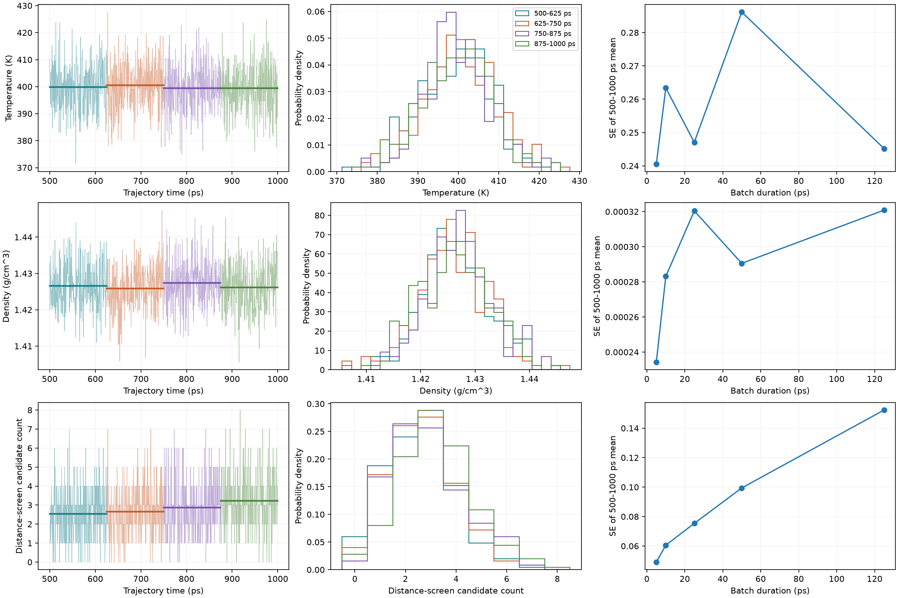
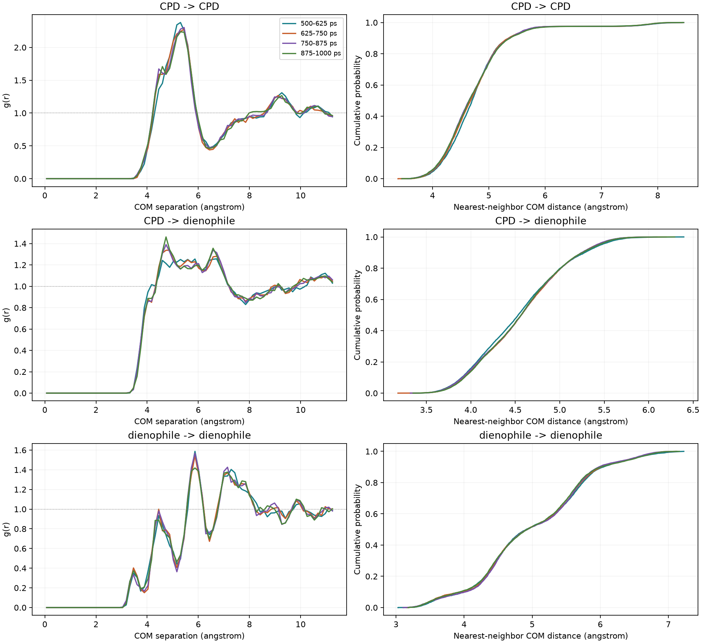

# Late-time NPT stability report

Four disjoint 125 ps blocks; 500 <= time < 1000 ps. The frame at 1000 ps is excluded
to give exactly 250 samples per block. All 80 molecules are retained (40 per species).

## Scalar summaries

Means +/- illustrative batch-mean standard errors using 25 ps batches (5 per block).
These errors are conditional on independent batches, not established confidence intervals.

| Trajectory block | Temperature (K) | Density (g/cm^3) | Candidate count |
|---|---:|---:|---:|
| 500-625 ps | 399.791 +/- 0.51 | 1.42657 +/- 0.000373 | 2.528 +/- 0.0671 |
| 625-750 ps | 400.496 +/- 0.473 | 1.42588 +/- 0.000686 | 2.656 +/- 0.143 |
| 750-875 ps | 399.472 +/- 0.606 | 1.42737 +/- 0.000549 | 2.876 +/- 0.108 |
| 875-1000 ps | 399.441 +/- 0.357 | 1.4262 +/- 0.000854 | 3.224 +/- 0.0402 |

### Reading these diagnostics

Candidate-count block means change by 27.5% from the first to last block.
Inspect the SE-versus-batch-duration curve before using the illustrative errors.
A rising curve can reflect slow correlations or drift; it does not identify the cause.
The four largest batches give a particularly noisy uncertainty estimate.
Autocorrelation summaries are saved in stability.json. First-zero truncation can
miss oscillatory correlations and slow tails, so its effective sample count must not
override the batch-duration diagnostic or be taken as proof of independent frames.

## Species-resolved COM packing

RDFs use minimum-image distances in each actual NPT box, normalized per frame
by volume and available pairs (same-species self pairs excluded).
All RDF bins lie below half the shortest box length. Nearest-neighbor distances
are pooled over central molecules and frames; they are correlated observations.

| Central -> neighbor species | 500-625 ps | 625-750 ps | 750-875 ps | 875-1000 ps |
|---|---:|---:|---:|---:|
| CPD -> CPD | 4.7759 | 4.7586 | 4.7465 | 4.7522 |
| CPD -> dienophile | 4.5544 | 4.5725 | 4.5666 | 4.5721 |
| dienophile -> dienophile | 5.0091 | 4.9977 | 5.0036 | 4.9897 |

Table: mean nearest-neighbor distances in angstrom.

## Limits

- No potential-energy or pressure series supplied.
- COM structure does not test internal conformation or reactive orientation.
- Fixed molecular identities inherited from COM extraction.
- No automatic equilibrium verdict; no independent replicas.
- Batch SE assumes decorrelation between batches; ACF estimates are heuristic.

Methods background: https://doi.org/10.33011/livecoms.1.1.5067
